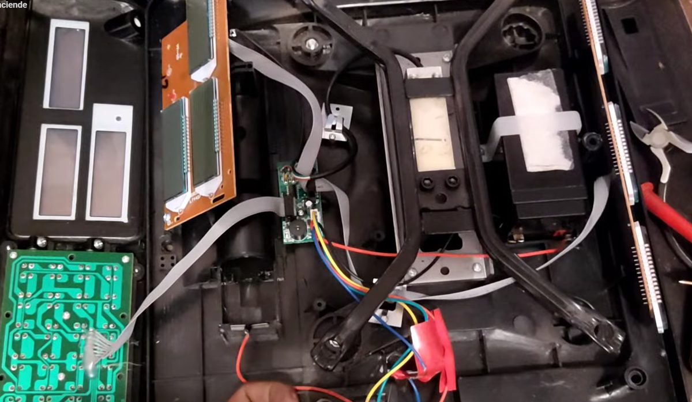
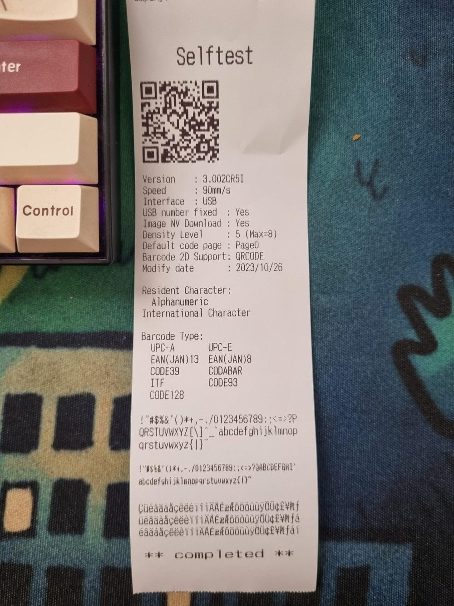
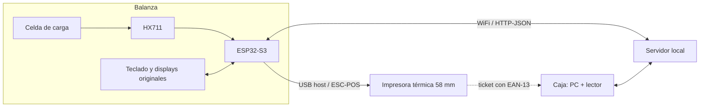

# Balanza de comercio con impresora de tickets (ESP32-S3)

Convierto una balanza comercial china genérica en una **balanza tipo supermercado**: se ingresa el código del producto, se pesa, y la balanza imprime un ticket con código de barras que después lee la caja. El cerebro es un **ESP32-S3** que maneja una impresora térmica **por USB**, sin computadora en el medio.

Es un proyecto real para la panificadora **Casa Nico** (La Quiaca, Jujuy), pensado para fabricar 3 o 4 unidades y crecer después a un sistema de caja en red y un SaaS.

| Balanza original abierta | Ticket de prueba de la impresora |
| --- | --- |
|  |  |

## Estado

- [x] **Impresora por USB desde el ESP32-S3** — el ESP32 actúa como *host* USB y le habla a una Xprinter XP-58IIH en ESC/POS.
- [x] **Factura simulada completa** — logo, detalle por peso y por unidad, total, QR y código de barras EAN-13 de balanza.
- [x] **Cola de impresión** — varios tickets seguidos sin desbordar la memoria de la impresora.
- [ ] Lectura de peso con HX711, tara y calibración.
- [ ] Manejo de los displays LCD y el teclado originales.
- [ ] Servidor local con la lista de productos y sincronización por WiFi.
- [ ] Sistema de caja con lector de código de barras.

## Cómo funciona

1. El empleado ingresa el código del producto (PLU) y pone la mercadería en el plato.
2. El ESP32 lee el peso, busca el producto en su copia local de la lista y arma el ticket.
3. El ticket sale con un **EAN-13 de peso variable**: `20` + PLU de 5 dígitos + peso en gramos de 5 dígitos + verificador. Ejemplo: `2 00123 01250 x` = producto 123, 1,250 kg.
4. En la caja, el lector de barras lee el código y el sistema busca el precio vigente en el servidor.

La balanza guarda una copia local de los productos, así que sigue funcionando aunque se corte la red.

## Hardware

| Pieza | Para qué |
| --- | --- |
| ESP32-S3 DevKitC-1 (dos puertos USB) | Cerebro. Un USB para programar y otro como *host* para la impresora |
| Xprinter XP-58IIH (USB, 58 mm, ESC/POS) | Impresora de tickets, externa y desmontable |
| Adaptador OTG USB-C a USB-A | Conecta la impresora al puerto nativo del ESP32 |
| Módulo HX711 | Lee la celda de carga original *(próxima etapa)* |
| Fuente 9 V + regulador LM2596 a 5 V | Alimentación de la electrónica |

El detalle de piezas, precios en Argentina (octubre de 2026) y margen está en [`presupuestos/`](presupuestos/).

## Contenido del repositorio

| Carpeta | Qué hay |
| --- | --- |
| [`firmware/factura_usb/`](firmware/factura_usb/) | **Firmware principal.** Imprime la factura por USB con cola de impresión y control de papel |
| [`firmware/factura_serial/`](firmware/factura_serial/) | Variante para impresoras de panel por puerto serie TTL/RS232 |
| [`herramientas/imagen_a_escpos.py`](herramientas/imagen_a_escpos.py) | Convierte cualquier logo al formato raster de la impresora (`.bin` para la PC y `.h` para el ESP32) |
| [`docs/`](docs/) | Decisiones técnicas, puesta en marcha, problemas resueltos y plan para los displays |
| [`presupuestos/`](presupuestos/) | Planillas de costos con fuentes |

## Probarlo

1. Instalá el [Arduino IDE 2](https://www.arduino.cc/en/software), el paquete **esp32 de Espressif** (3.2.0 o posterior) y la librería **EspUsbHost** (2.10.0 o posterior).
2. Abrí `firmware/factura_usb/factura_usb.ino`. Placa: *ESP32S3 Dev Module*, *USB CDC On Boot: Disabled*, *USB Mode: Hardware CDC and JTAG*.
3. Programá por el puerto **UART/COM** y conectá la impresora al puerto **USB nativo** con el OTG.
4. En el Monitor Serie (115200), esperá "Impresora lista" y escribí `p`.

La guía completa, con capturas del monitor serie y solución de problemas, está en [`docs/puesta-en-marcha.md`](docs/puesta-en-marcha.md).

## Lo que aprendí

- **USB host en un microcontrolador.** Una impresora USB "de PC" se puede manejar desde un ESP32-S3 sin drivers: es una interfaz de clase 0x07 con un *endpoint* bulk de salida. El modelo usado no estaba verificado con la librería; lo comprobé con el estado en tiempo real de ESC/POS (`DLE EOT`) antes de imprimir.
- **Controlar el flujo de datos importa.** La impresora tiene 32 KB de memoria y cada ticket con logo ocupa 14,5 KB. Mandar tickets seguidos la desbordaba y dejaba uno a medias. Lo resolví con una cola que espera a que termine el anterior y un reinicio del buffer ante fallas.
- **Las páginas de códigos.** La impresora usa PC437, donde existen á é í ó ú ñ pero no Á Í Ó Ú. El firmware convierte UTF-8 a esa tabla y apaga el modo de caracteres chinos de fábrica.
- **Diseñar para la falla.** Antes de comprar, armé planes de contingencia con probabilidad, costo y dificultad para cada riesgo (por ejemplo, [los displays originales](docs/plan-displays.md)).

Más detalle en [`docs/problemas-resueltos.md`](docs/problemas-resueltos.md) y [`docs/decisiones-tecnicas.md`](docs/decisiones-tecnicas.md).

## Créditos

- Archivos `PrinterDevice.hpp`, `EscPos.hpp` y `PrinterProtocol.hpp`: tomados del ejemplo de [EspUsbHost](https://github.com/tanakamasayuki/EspUsbHost) de TANAKA Masayuki, licencia MIT. Ver [`THIRD_PARTY_NOTICES.md`](THIRD_PARTY_NOTICES.md).
- El logo de Casa Nico pertenece a su comercio y se incluye solo como ejemplo de impresión.

Código propio bajo licencia [MIT](LICENSE).
