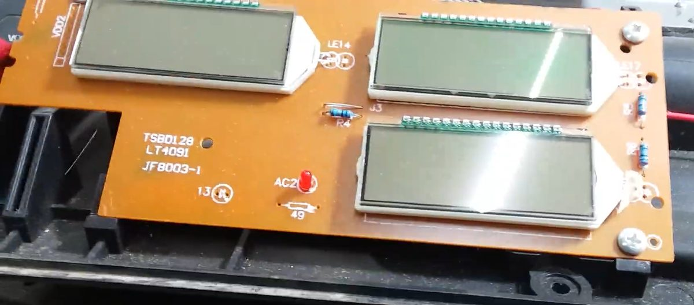

# Plan para los displays originales

Los displays son 3 LCD de segmentos multiplexados en una placa propia (serigrafía TSBD128 / LT4091 / JF8003-1), unida a la placa principal por **8 cables**.

Un LCD multiplexado no se puede manejar directo desde un microcontrolador: necesita señales alternadas con tensiones intermedias, y la tensión continua lo degrada. Como cada vidrio tiene unas 16 líneas y solo llegan 8 cables, el chip que los maneja está en la propia placa de displays. El ESP32 tiene que hablarle a ese chip por esos 8 cables.

## Escenarios

Sin poder ver el dorso de la placa, el tipo de chip se identifica midiendo los 8 cables con un tester y "escuchando" la comunicación de la placa original con un analizador lógico. Las probabilidades son estimaciones según lo que se ve y cómo suelen venir estas balanzas.

| Escenario | Probabilidad | Cómo se reconoce | Costo extra | Dificultad | Tiempo |
| --- | --- | --- | --- | --- | --- |
| 1. Driver estándar de 3 hilos tipo HT1621 | ~60 % | 3 señales: selección, reloj y datos | $ 0 a $ 20.103 | Baja | 1 a 3 días |
| 2. Driver estándar I2C | ~20 % | 2 señales: reloj y datos | $ 0 a $ 20.103 | Baja | 1 a 3 días |
| 3. Protocolo propio (micro en la placa de displays) | ~15 % | 1 línea tipo puerto serie, o algo que no coincide con chips conocidos | $ 20.103 | Media-alta | 1 a 2 semanas |
| 4. No se logra o se daña la placa | ~5 % | Se vence el plazo sin avances | ~$ 60.000 (estimado) | Media | 3 a 5 días + compras |

Además, si la placa funciona a 5 V se agrega un adaptador de niveles TXS0108E ($ 2.985).

## Plan por escenario

- **1 y 2:** copiar con el analizador la inicialización que manda la placa original, y armar el mapa de segmentos prendiéndolos de a uno desde el ESP32.
- **3:** grabar capturas con distintos números en pantalla y deducir el formato de los mensajes.
- **4:** reemplazar los vidrios por 6 módulos LCD de 6 dígitos con HT1621 (3 de frente, 3 de dorso), que se manejan con 3 cables.

**Regla de corte:** si en 5 días de trabajo no se logra prender un dígito controlado desde el ESP32, se pasa al escenario 4.

**Compra recomendada antes de empezar:** analizador lógico de 8 canales y 24 MHz (unos $ 20.000) y adaptador de niveles. Cubren los escenarios 1 a 3, cerca del 95 % de los casos. El costo esperado ponderado por probabilidad es de unos $ 15.000.

*Precios relevados en tiendas argentinas en octubre de 2026.*
